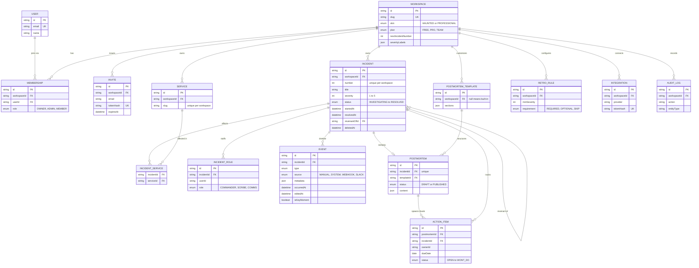

# The Crypt: Product Requirements

Oct 22, 2026 · @Mikaila Brown

## Overview

The Crypt is a lightweight incident and postmortem tracker for small engineering teams, built as a real multi-tenant SaaS with a switchable horror skin. It wins on what happens after the incident: catching repeat failures and making sure follow-up work actually gets done.

**The problem.** Teams write a postmortem, assign action items, and then lose track of both. The same failure returns weeks later and nobody connects it to the earlier one. Existing tools such as incident.io, Rootly and FireHydrant cover live response and on-call well, but they are heavy for a team that mainly wants a clean incident record and reliable follow-through.

**The pitch.** Declare a haunting, keep a timeline, write an autopsy, and complete the rituals that stop it coming back.

**What makes it different**

- **Revenant detection:** recurring incidents are flagged automatically, with a count of how many times the same trouble has returned
- **Action-item accountability:** every postmortem produces owned, dated action items that surface on the dashboard when overdue
- **Blameless templates:** postmortem prompts focus on causes and learning, not individuals
- **Two skins, one product:** a Haunted skin for personality and a Professional skin so the product stays sellable year-round

## Users and use cases

The Crypt serves four kinds of people in a small engineering organization, and the product is built around the first three.

| User | What they need | Key use cases |
| --- | --- | --- |
| Responder | Record what is happening fast, without ceremony | Declare an incident, post timeline updates, change status and severity |
| Incident commander | Keep one clear picture and a clean handoff | Assign roles, track status, resolve and reopen, decide when a postmortem is needed |
| Engineering manager | See patterns and make sure follow-up happens | Review repeat incidents, check overdue action items, read postmortems |
| Workspace admin | Set rules and manage who has access | Invite members, define services, set postmortem requirements, choose the skin |

**Target team.** Engineering teams of roughly 5 to 50 people who respond to incidents in Slack or chat today and keep notes in documents or tickets. These teams have outgrown ad hoc notes but do not need an enterprise incident-response suite.

## Product principles

Five rules decide trade-offs when requirements conflict.

1. **Postmortem first.** Features that improve learning and follow-through outrank features that duplicate live-response tools.
2. **The theme is a skin, not the product.** With the horror copy removed, the app must still look and work like a credible B2B tool: neutral base, one accent color, dense and calm layouts.
3. **One skin at a time.** The workspace setting picks Haunted or Professional and the whole app renders that one. Layouts are identical in both. Stored values (statuses, roles, event types) are skin-neutral, and every user-facing string comes from a copy dictionary with a version for each skin.
4. **Blameless by design.** Templates and prompts ask what happened and what the system allowed, never who caused it.
5. **Tenant isolation by default.** Every query is scoped to a workspace through shared helpers, so a forgotten filter cannot leak data.

## Scope by milestone

The build is split into eight shippable milestones; the first three are underway. Each has a "done when" check that must be demonstrated, not just compiled.

| # | Milestone | Scope | Done when | Status |
| --- | --- | --- | --- | --- |
| 1 | Accounts and workspaces | Magic-link and GitHub sign-in, workspaces, members and roles, invites, workspace switcher | Two accounts share a workspace and a third account in another workspace cannot see its data | Built |
| 2 | Services and incidents | Services, declare incident, filterable incidents list, incident detail page with roles and status changes | An incident can be declared, filtered, updated and resolved, and the resolved time is set automatically | In progress: services, declare flow and list built, detail page remaining |
| 3 | Timeline | Event feed, manual notes, backdating, key moments, filters | Every change appears in the timeline with who made it and when | Prompt ready |
| 4 | Postmortems | Templates, editor with autosave, draft and published states, required-by-severity rule | A resolved high-severity incident shows "autopsy required" until published | Planned |
| 5 | Action items | Items from postmortems with owner and due date, board view, my-items list, overdue highlighting | Dragging a card changes status and persists after refresh | Planned |
| 6 | Revenants and accountability | Similar-incident suggestions, linking, recurrence counts, overdue items on the dashboard | Declaring a near-duplicate title suggests the earlier incident | Planned |
| 7 | Dashboard and settings | Stat cards, incidents-per-month chart, needs-attention list, retro rules, skin toggle, severity label overrides | Dashboard numbers come from real data | Planned |
| 8 | Product site | Landing, pricing, FAQ, plan limits on Free, audit log page | A visitor can understand and sign up for the product from the site | Planned |

## Functional requirements

Requirements are grouped by product area. Haunted-skin names appear in parentheses.

### Accounts, workspaces and members

- Sign up and sign in with an email magic link or GitHub; protected routes redirect to sign-in
- A new user without a workspace is guided to create one and becomes its owner
- Workspaces have a unique, validated slug and are reached at /app/{slug}
- Owners and admins invite people by email with a role; invite tokens are stored hashed and expire after 7 days
- A workspace always keeps at least one owner; only owners can grant or remove the owner role

### Incidents (hauntings)

- Declare an incident with title, summary, severity 1 to 5, affected services and start time (editable for backfill)
- Each incident gets a per-workspace sequence number, allocated atomically so concurrent declares never collide
- Statuses: Investigating (Lurking), Identified (Possessed), Mitigating (Exorcising), Resolved (Laid to Rest)
- Resolving sets the resolved time; reopening clears it
- Three roles per incident: Commander (Exorcist), Scribe, Comms (Medium)
- The incidents list supports search, filters by status, severity, service and date, sorting, cursor pagination, and shareable URLs
- Admins can soft-delete an incident; deleted incidents never appear anywhere

### Timeline (séance log)

- Automatic entries for status, severity, role, service and title changes, each written as a readable sentence
- Members add markdown notes, optionally backdated; future times are rejected and later-added entries are marked
- Authors edit or delete their own notes; admins can edit or delete any; system entries are immutable
- Notes can be starred as key moments (omens), which feed the postmortem
- The feed refreshes itself about every 15 seconds and loads long timelines in pages

### Postmortems (autopsy reports)

- One postmortem per incident, created from a template with sections such as cause, impact, timeline and lessons
- Autosaving editor with draft and published states; unpublishing is an admin action
- Retro rules require a postmortem for incidents at or above a chosen severity, within a set number of days after resolution
- Overdue postmortems are flagged on the dashboard

### Action items (rituals)

- Created from a postmortem with an owner, due date and status: Open, In progress, Done, Won't do
- Board view with drag-and-drop between status columns, plus a personal list filtered to the signed-in user
- Overdue items are highlighted and counted on the dashboard

### Revenant detection

- When an incident is declared, suggest earlier incidents with similar titles or shared services using Postgres trigram matching
- A person confirms the link; linked incidents show how many times the trouble has returned
- Services show recurring-incident counts

### Dashboard and settings

- Dashboard: open incidents, mean time to resolve, overdue action items, revenant rate, incidents per month, needs-attention list
- Settings: workspace name, skin toggle, severity label overrides, retro rules, members, services, invites

## Data model

The data lives in Postgres (hosted on Neon) through Prisma, with a workspace at the center: every tenant-owned table carries a workspace id. The diagram shows key columns only; names follow the repository (for example Event and STATUS\_CHANGED), which differ slightly from the earlier reference file (IncidentEvent, STATUS\_CHANGE).

**Design decisions**

- **Skin-neutral enums.** The database stores INVESTIGATING, never "Lurking"; the copy dictionary maps values to labels per skin.
- **One timeline table.** Notes, system events and future webhook or Slack events all land in Event with a different source, so integrations need no schema change.
- **Revenants are a self-reference.** An incident points at the first incident in its recurring chain; candidates come from a trigram index on titles plus shared services.
- **Atomic numbering.** A per-workspace counter produces numbers like INC-42 or Haunting #42 without gaps from races.
- **Soft delete for incidents,** hard delete only for manual notes, with an audit row either way.
- **Database guards.** A check constraint enforces severity 1 to 5, and a trigram index supports similarity search.

## Roles and permissions

Every member can do the day-to-day work of responding and writing; admins control structure and cleanup; owners control ownership. A person who is not a member of a workspace gets a not-found response, never a permission error, so workspaces cannot be probed.

| Action | Member | Admin | Owner |
| --- | --- | --- | --- |
| View incidents, timeline, postmortems, action items | Yes | Yes | Yes |
| Declare and update incidents, change status | Yes | Yes | Yes |
| Assign incident roles | Yes | Yes | Yes |
| Add timeline notes | Yes | Yes | Yes |
| Edit or delete own notes | Yes | Yes | Yes |
| Edit or delete anyone's notes | No | Yes | Yes |
| Create, edit and publish postmortems | Yes | Yes | Yes |
| Unpublish a postmortem | No | Yes | Yes |
| Create action items | Yes | Yes | Yes |
| Edit an action item | Its owner | Yes | Yes |
| Soft-delete an incident | No | Yes | Yes |
| Create, rename and delete services | No | Yes | Yes |
| Set retro rules, skin and severity labels | No | Yes | Yes |
| Invite members and change member roles | No | Yes | Yes |
| View the audit log | No | Yes | Yes |
| Grant or remove the owner role | No | No | Yes |
| Leave the workspace | Yes | Yes | Only if another owner exists |

## Non-functional requirements

These apply to every milestone and are checked before it counts as done.

- **Tenant isolation.** All access goes through a workspace context helper and a scoped database helper. Each milestone adds tests proving one workspace cannot read or change another's data.
- **Security.** Request bodies are validated with Zod. Invite tokens are stored as SHA-256 hashes. User-written markdown is sanitized before rendering. Destructive actions confirm first, and sensitive changes write an audit log entry that excludes note contents.
- **Performance.** Lists use cursor pagination with a stable tie-break; the incidents list loads 25 rows at a time and the timeline 50. Search and filter columns are indexed, and similarity search uses a trigram index.
- **Accessibility.** Both skins meet WCAG AA contrast. Animations respect the reduced-motion setting. Every flow works with a keyboard.
- **Responsive design.** Core screens work at 390 px wide as well as desktop.
- **Data integrity.** Incident numbers are allocated atomically, severity is constrained to 1 to 5 in the database, and seed scripts are safe to run repeatedly.
- **Quality gates.** Each milestone passes typecheck, lint, unit tests, database tests and a production build, followed by a manual click-through in both skins.
- **Extensibility.** The Event and Integration tables and the plan field exist from the start so Slack, webhooks and billing can be added without reshaping the data.

## Success metrics

Success means teams finish postmortems and close their action items, not just log incidents. Targets are left blank until the first real workspaces produce a baseline.

| Metric | Definition | Why it matters | Target |
| --- | --- | --- | --- |
| Activation | Share of new workspaces that declare an incident within 7 days of sign-up | Shows the product is understood quickly | To be set |
| Postmortem completion | Resolved incidents needing a postmortem that are published by the due date | The core promise of the product | To be set |
| Action-item completion | Action items marked Done by their due date | Measures follow-through | To be set |
| Revenant link rate | Incidents linked to an earlier occurrence, divided by all incidents in the period | Shows the differentiator is used | To be set |
| Mean time to resolve | Average of resolved time minus start time for incidents resolved in the period | Standard reliability signal shown on the dashboard | Trend, no target |
| Weekly active workspaces | Workspaces with at least one incident, note or action-item change in the week | Overall engagement | To be set |

## Out of scope and later roadmap

The first eight milestones deliberately exclude live-response features. Each item below already has an extension point so it can be added without reworking the data model.

| Later feature | What it adds | Where it plugs in |
| --- | --- | --- |
| Slack slash command | Declare and update incidents from chat, with a channel per incident | Integration table, Event source SLACK |
| Webhook ingest | Alerts from monitoring tools appear on the timeline | Integration ingest token, Event source WEBHOOK |
| Public status page | A customer-facing page for ongoing incidents | Reads incidents and services |
| Runbooks | Condition-triggered checklists for responders | New table keyed to services and severities |
| Ticket sync | Action items mirrored to Jira, Linear or Asana | External provider and URL fields on action items |
| AI-drafted postmortems | A first draft from the timeline and key moments | Reads Event rows and key moments |
| On-call scheduling and paging | Rotations and escalation | Separate module; not planned near term |
| Stripe billing | Paid plans and limits | Plan field on the workspace |

## Risks and open questions

The biggest risks are a crowded market and a UI that nobody has looked at yet.

### Risks

| Risk | Why it matters | Mitigation |
| --- | --- | --- |
| Crowded market | incident.io, Rootly and FireHydrant already offer free or low-cost tiers | Compete on postmortem quality, revenant detection and follow-through, not on paging |
| Theme reads as a gimmick | Heavy Halloween styling can make the product look unserious to buyers | Professional skin as a first-class option; haunted skin limited to copy, icons and a tasteful dark theme |
| Unverified UI | Milestones are checked by unit and database tests, which cannot catch layout or mobile problems | Manual click-through per milestone in both skins, with screenshots shared for review |
| Schema drift | The repository's names already differ from the earlier reference document | Treat the repository schema as the source of truth and update this document's diagram as it changes |
| Seasonal appeal | A Halloween launch fades after October | Keep the skin toggle; plan a plain-language marketing page for year-round use |

### Open questions

- Is the target team size of roughly 5 to 50 people right, or should the first customers be smaller?
- Should pricing be flat per workspace or per seat? Flat pricing undercuts per-seat tools but caps revenue growth.
- Which integration comes first after Milestone 8: the Slack command or the public status page?
- Should the postmortem editor use a full rich-text editor or markdown with a preview?
- What history and member limits define the Free plan?
- Should revenant suggestions ever link automatically, or always require confirmation?
